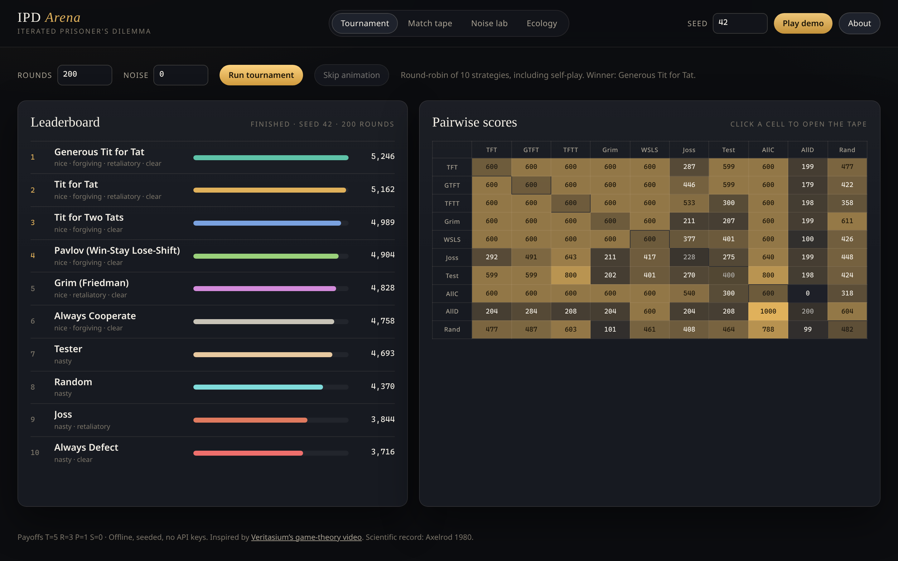
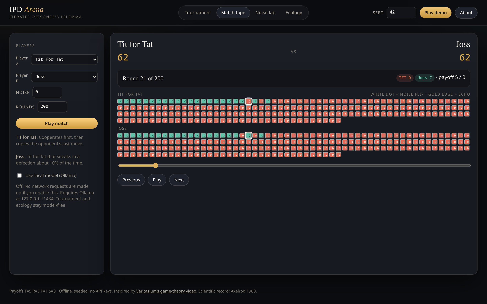
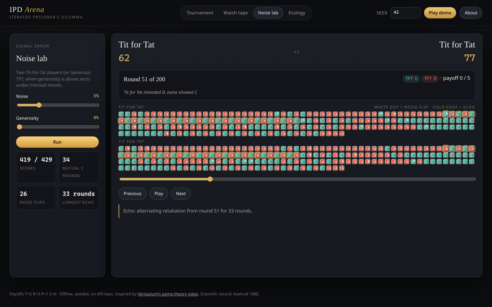
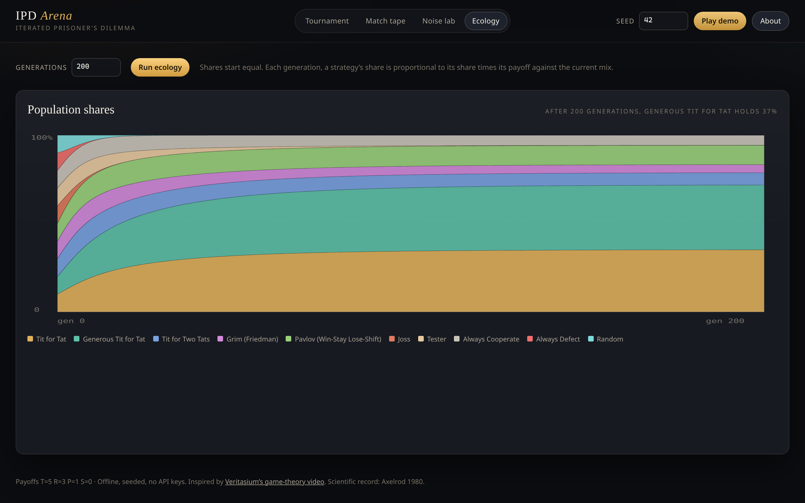

# IPD Arena

A visual lab for the iterated prisoner’s dilemma. Watch classic strategies compete in a tournament, scrub a cooperate/defect tape, inject noise, and see population shares shift over generations.



<p align="center">
  
  
  
</p>

The engine is seeded and deterministic. The app is a static site with **no runtime network requests**, no API keys, and no npm dependencies. An optional local-model player (Ollama on your machine) is off by default and is never used in the tournament or ecology views.

## Run

No install step.

```bash
python3 -m http.server 8765
```

Then open [http://127.0.0.1:8765](http://127.0.0.1:8765). `npm start` runs the same command. You can also open `index.html` directly in a browser (`file://`).

```bash
npm test
```

runs the unit tests with Node’s built-in test runner (`node --test`). CI on GitHub Actions does the same.

## 30-second demo

Or click **Play demo** in the app (seed 42).

1. **Tournament.** Leave the seed at 42 and click **Run tournament**. Watch the live leaderboard and the pairwise matrix. Nice strategies (Tit for Tat and its kin) should sit near the top; Always Defect should not win this mixed field.
2. **Match tape.** Click the Tit for Tat vs Joss cell, or open Match tape and pick those two. Scrub to Joss’s first sneak. An echo of alternating retaliation often follows.
3. **Noise lab.** Leave generosity at 0%, set noise to 5%, click **Run**. Two Tit-for-Tat players usually spiral after a misread move. Raise generosity to 10% and run again — the spiral often shortens or breaks, and mutual cooperation recovers more often.
4. **Ecology.** Click **Run ecology**. Shares start equal. Exploiters can boom, then fade as the strategies they prey on shrink.

## What this shows (and what it doesn’t)

This is a demonstration of well-known results, not a claim of new science.

- In a mixed field, strategies that are *nice* (don’t defect first), *forgiving*, *retaliatory*, and *clear* tend to do well. That is the shape of Axelrod’s 1980 tournaments, recomputed here from scratch.
- There is **no single best strategy**. Tit for Tat does poorly in a world of Always Defect. Tit for Two Tats is extra forgiving — and can be exploited when the field changes.
- Most of this game is **not zero-sum**. A strategy can fail to beat any given opponent head-to-head and still finish first overall.
- **Noise** (a cooperate read as a defect) can lock two Tit-for-Tats into a retaliation echo. A little **generosity** can break it.

Nothing here is financial advice, and the project makes no claims about markets or returns.

Inspired by [Once you understand game theory, you understand the world](https://youtu.be/mScpHTIi-kM) (Veritasium, 2023). The scientific record is Axelrod 1980a/b and later work on generous Tit for Tat under noise.

## What’s included

| File | Role |
| --- | --- |
| `js/engine.js` | Seeded RNG, payoffs, match, tournament, ecology, echo detection |
| `js/strategies.js` | Tit for Tat, Generous TFT, Tit for Two Tats, Grim (Friedman), Pavlov (Win-Stay Lose-Shift), Joss, Tester, Always C/D, Random |
| `js/ollama.js` | Optional local-model player; no fetch until enabled |
| `js/app.js` | The four views and the guided demo |
| `test/engine.test.js` | Payoffs, seeds, known outcomes, noise, generosity, tournament, ecology |

v0.1 does not include a spatial “island of cooperators” map, paid APIs, or a public package.

## License

MIT. See [LICENSE](LICENSE).
